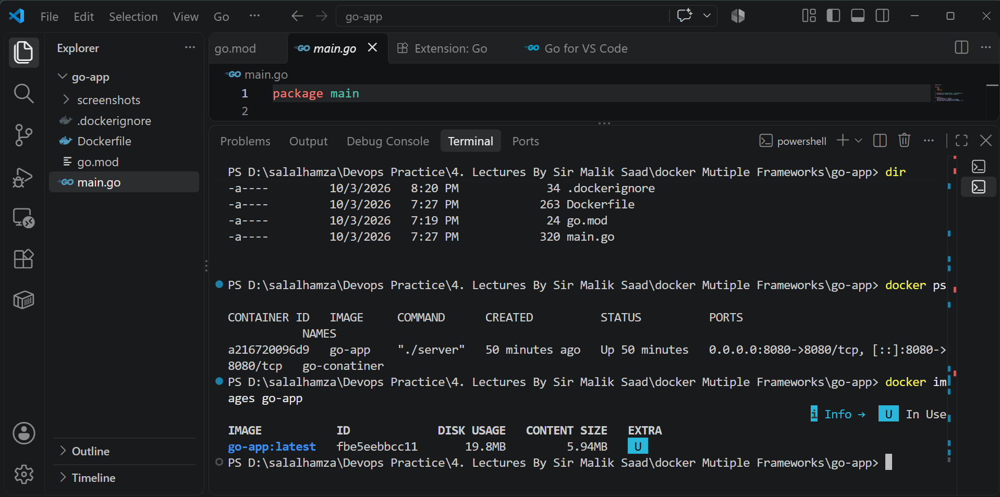
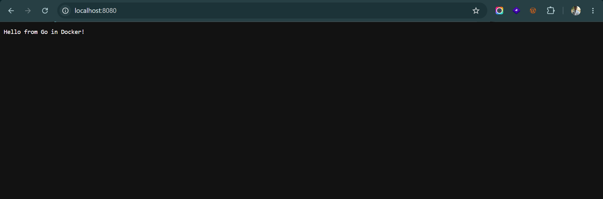

# Go Application Containerization

## 1. Application Name
- Application: Go HTTP Server
- Framework / Runtime: Go (Golang)

## 2. Base Image Selected
- Builder Base Image: golang:1.22-alpine
- Runtime Base Image: alpine:latest
- Reason: golang:1.22-alpine provides the Go compiler needed to build the static binary. alpine:latest provides an ultra-minimal runtime environment containing only the compiled binary, keeping the final image tiny.

## 3. Port Used
- Container Internal Port: 8080
- Host Browser Port: 8080
- URL: http://localhost:8080

## 4. Dockerfile Explanation
- FROM golang:1.22-alpine AS builder: Initializes the build stage with the Go toolchain.
- WORKDIR /app: Sets the working directory.
- COPY go.mod ./: Copies dependency manifests first to cache module downloads.
- RUN go mod download: Downloads dependencies if present.
- COPY . .: Copies the Go source code.
- RUN CGO_ENABLED=0 GOOS=linux go build -ldflags="-s -w" -o server .: Compiles a standalone static binary without CGO and strips debugging information (-s -w) to minimize binary size.
- FROM alpine:latest: Starts a clean minimal runtime stage without compilers.
- COPY --from=builder /app/server .: Copies only the compiled binary from the builder stage.
- EXPOSE 8080: Documents the port the server listens on.
- CMD ["./server"]: Executes the compiled application binary.

## 5. Build and Run Commands
Build command:
docker build -t go-app .

Run command:
docker run -d -p 8080:8080 --name go-container go-app

View logs:
docker logs go-container

## 6. Image Size
- Final Image Size: ~15 MB
- Optimization: Used a multi-stage Docker build, stripped symbol tables with ldflags, and discarded all build tools from the final runtime image.

## 7. Assignment Questions Answered
1. Which base image fits this runtime, and why?
   golang:1.22-alpine fits the build stage for compilation, and alpine:latest fits the final runtime image because compiled Go binaries do not need the Go compiler to run.

2. Which files must be copied before installing dependencies so that rebuilds stay fast?
   go.mod (and go.sum if present) must be copied before the source code so Docker can cache the downloaded modules layer.

3. Does the app need a build step? Does the final image need the build tools?
   Yes, Go is a compiled language and requires a build step to produce an executable binary. The final image does not need any build tools.

4. Which address must the server listen on so the browser can reach it from outside the container?
   The server must listen on 0.0.0.0:8080 (all network interfaces).

5. What is the command that starts the app?
   ./server (the compiled binary executable).

## 8. Verification Screenshots
Build and image size:

Browser response:
