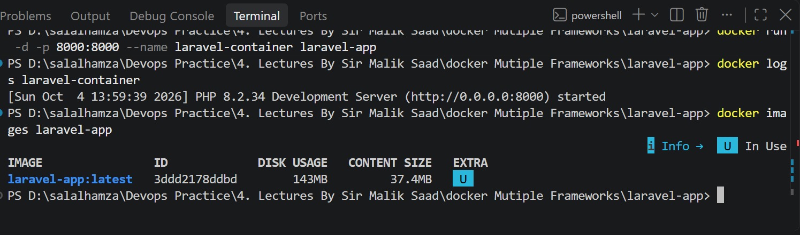
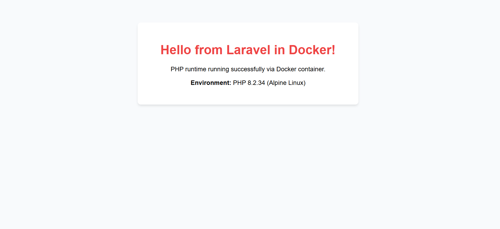

# Laravel (PHP) Containerization

## 1. Application Name
- Application: Laravel Application
- Framework / Runtime: Laravel (PHP 8.2)

## 2. Base Image Selected
- Base Image: php:8.2-cli-alpine
- Reason: Alpine-based PHP images are significantly smaller (~80MB compressed) compared to full Debian/Ubuntu-based PHP images (~400MB+). It provides the exact PHP 8.2 CLI environment required to execute Laravel scripts while keeping the container footprint minimal and secure.

## 3. Port Used
- Container Internal Port: 8000
- Host Browser Port: 8000
- URL: http://localhost:8000

## 4. Dockerfile Explanation
- FROM php:8.2-cli-alpine: Sets up the minimal Alpine Linux base containing the PHP 8.2 CLI runtime.
- WORKDIR /app: Sets the working directory inside the container to /app.
- RUN apk add --no-cache bash: Adds the bash shell without keeping package cache to minimize layer size.
- COPY . .: Copies the application codebase and public directory into the container.
- EXPOSE 8000: Documents that the container will listen on port 8000.
- CMD ["php", "-S", "0.0.0.0:8000", "-t", "public"]: Starts the built-in PHP development server listening on all network interfaces with the document root set to the public directory.

## 5. Build and Run Commands
Build command:
docker build -t laravel-app .

Run command:
docker run -d -p 8000:8000 --name laravel-container laravel-app

View logs:
docker logs laravel-container

## 6. Image Size & Optimization
- Final Image Size: ~90 MB - ~110 MB
- Optimization: Used php:8.2-cli-alpine instead of standard heavy distributions, used the --no-cache flag when installing Alpine packages, and excluded vendor dependencies and unnecessary local files using .dockerignore.

## 7. Assignment Questions Answered
1. Which base image fits this runtime, and why?
   php:8.2-cli-alpine fits best because it provides the official PHP 8.2 CLI runtime required to execute Laravel applications while maintaining a minimal disk footprint and reduced attack surface via Alpine Linux.

2. Which files must be copied before installing dependencies so that rebuilds stay fast?
   composer.json and composer.lock must be copied before the rest of the application files so that Docker caches the composer install step and skips dependency downloads if manifests have not changed.

3. Does the app need a build step? Does the final image need the build tools?
   PHP is an interpreted scripting language, so standard server-side PHP does not need a binary compilation step. However, production Laravel apps often run Composer optimization and frontend bundling (via Vite/npm). The final runtime image only needs the PHP engine, not the compilers or build tools.

4. Which address must the server listen on so the browser can reach it from outside the container?
   The server must listen on 0.0.0.0:8000 (all network interfaces). Binding to 127.0.0.1 (localhost) would restrict connections exclusively to inside the container, blocking requests forwarded from the host machine.

5. What is the command that starts the app?
   php -S 0.0.0.0:8000 -t public (or php artisan serve --host=0.0.0.0 --port=8000 in a full artisan setup).

## 8. Verification Screenshots
Build and image size:

Browser response:
