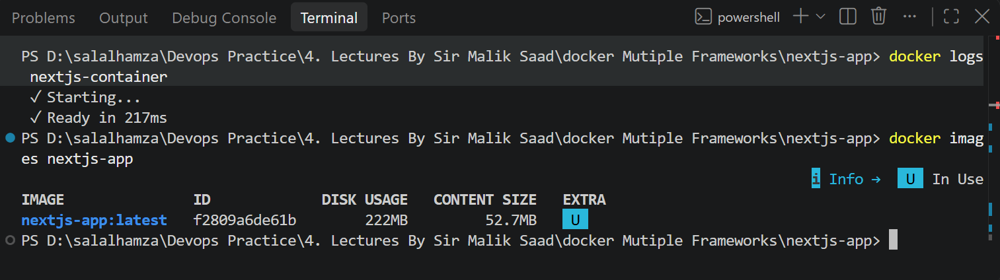
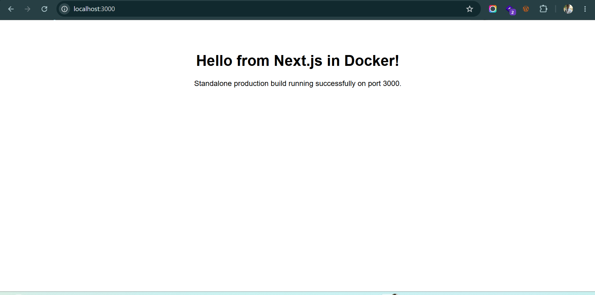

# Next.js Application Containerization

## 1. Application Name
- Application: Next.js Standalone Production Server
- Framework / Runtime: Next.js (React / Node.js)

## 2. Base Image Selected
- Base Image: node:20-alpine
- Reason: Alpine Linux offers a tiny footprint (~50MB compressed) compared to the standard full Debian Node image (~1GB). It minimizes vulnerabilities, decreases build/transfer times, and supplies the necessary Node.js engine to run the standalone build.

## 3. Port Used
- Container Internal Port: 3000
- Host Browser Port: 3000
- URL: http://localhost:3000

## 4. Dockerfile Explanation
- Stage 1 (deps): Uses node:20-alpine to copy package manifests and run npm install to cache dependencies.
- Stage 2 (builder): Copies source code and node_modules, then runs npm run build to compile the Next.js standalone server and static assets.
- Stage 3 (runner): A minimal node:20-alpine runtime environment set to NODE_ENV=production.
- COPY --from=builder: Only copies the standalone build output (.next/standalone), static files (.next/static), and public folder, discarding all build tools and unused dependencies.
- EXPOSE 3000: Documents the communication port.
- CMD ["node", "server.js"]: Launches the lightweight Next.js standalone server directly.

## 5. Build and Run Commands
Build command:
docker build -t nextjs-app .

Run command:
docker run -d -p 3000:3000 --name nextjs-container nextjs-app

View logs:
docker logs nextjs-container

## 6. Image Size & Optimization
- Final Image Size: ~140 MB - ~200 MB
- Optimization: Implemented a multi-stage Docker build with Next.js output: 'standalone'. This extracts only the necessary node_modules and runtime files, cutting image size by over 70% compared to a non-standalone build.

## 7. Assignment Questions Answered
1. Which base image fits this runtime, and why?
   node:20-alpine fits best because Next.js standalone mode only requires the Node.js runtime to execute server.js, and Alpine provides this in the smallest official footprint.

2. Which files must be copied before installing dependencies so that rebuilds stay fast?
   package.json and package-lock.json must be copied first. Docker caches the npm install layer so dependency downloads do not repeat unless packages are modified.

3. Does the app need a build step? Does the final image need the build tools?
   Yes, Next.js requires a build step (next build) to pre-render pages, compile React components, and generate static assets. However, the final runtime image does not need the build tools or developer dependencies, only the compiled standalone output.

4. Which address must the server listen on so the browser can reach it from outside the container?
   It must listen on 0.0.0.0 (all network interfaces). In Next.js, this is configured via the environment variable HOSTNAME="0.0.0.0".

5. What is the command that starts the app?
   node server.js (executed in the runner stage from the standalone directory).

## 8. Verification Screenshots
Build and image size:

Browser response:
