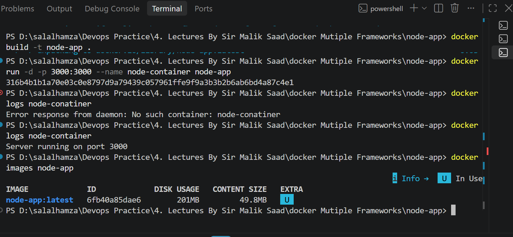
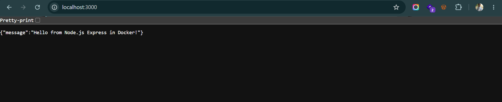

# Node.js (Express) Containerization

## 1. Application Name
- Application: Node.js Express Server
- Framework / Runtime: Node.js

## 2. Base Image Selected
- Base Image: node:20-alpine
- Reason: Alpine Linux is lightweight (~50MB compressed) compared to default Debian images (~1GB). It minimizes security risks, reduces download times, and provides a complete Node.js and npm runtime.

## 3. Port Used
- Container Internal Port: 3000
- Host Browser Port: 3000
- URL: http://localhost:3000

## 4. Dockerfile Explanation
- FROM node:20-alpine: Uses the lightweight Node 20 Alpine official base image.
- WORKDIR /app: Sets the working directory inside the container.
- COPY package*.json ./: Copies dependency manifests first to leverage Docker layer caching.
- RUN npm install: Installs runtime dependencies inside the image.
- COPY . .: Copies application source code into the container.
- EXPOSE 3000: Documents the port that the container listens on.
- CMD ["node", "server.js"]: Starts the Express application server.

## 5. Build and Run Commands
Build command:
docker build -t node-app .

Run command:
docker run -d -p 3000:3000 --name node-container node-app

View logs:
docker logs node-container

## 6. Image Size
- Final Image Size: ~201 MB
- Notes: Size kept small by using Alpine base image and ignoring node_modules locally using .dockerignore.

## 7. Assignment Questions Answered
1. Which base image fits this runtime, and why?
   node:20-alpine fits best because it contains the Node.js runtime and npm in a tiny footprint without unnecessary operating system packages.

2. Which files must be copied before installing dependencies so that rebuilds stay fast?
   package.json and package-lock.json must be copied first. Docker caches the npm install step unless these manifest files change.

3. Does the app need a build step? Does the final image need the build tools?
   No, standard Express JavaScript does not require a compilation or build step. It runs directly via Node.js, so build tools are not needed.

4. Which address must the server listen on so the browser can reach it from outside the container?
   It must listen on 0.0.0.0 (all network interfaces). If it listens on 127.0.0.1 (localhost only), it will not accept forwarded requests from outside the container.

5. What is the command that starts the app?
   node server.js (executed via CMD in the Dockerfile).

## 8. Verification Screenshots
Build and logs:

Browser response:
